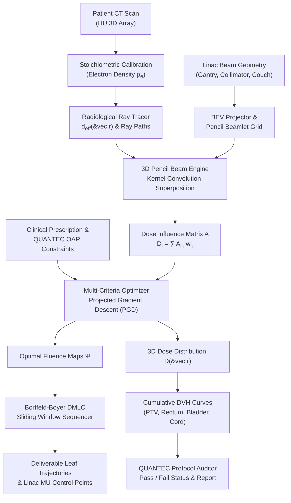

# RadBeam

[](https://github.com/ZengLLQ/rad-beam/actions/workflows/ci.yml)
[](https://www.python.org/downloads/)
[](https://opensource.org/licenses/MIT)
[](https://doi.org/10.1016/j.ijrobp.2009.10.023)

**RadBeam** is a high-performance clinical radiotherapy treatment planning engine and medical physics simulator implemented in Python. It features 3D megavoltage polyenergetic pencil beam convolution-superposition (PBCS), 3D CT stoichiometric electron density calibration, multi-criteria inverse planning optimization via Projected Gradient Descent (PGD), Bortfeld-Boyer dynamic sliding-window multileaf collimator (MLC) leaf sequencing, differential and cumulative Dose-Volume Histogram (DVH) analysis, and automated QUANTEC/RTOG organ-at-risk (OAR) clinical compliance auditing.

---

## Key Capabilities

- **3D Pencil Beam Convolution-Superposition (PBCS):** Polyenergetic radial-depth kernels calibrated for clinical 6 MV Linac spectra with depth-dependent Gaussian lateral scatter and source-to-surface inverse-square divergence.
- **Stoichiometric CT Heterogeneity Modeling:** Multi-region Hounsfield Unit (HU) to relative electron density ($\rho_e$) calibration (air, lung, adipose, muscle, trabecular, and cortical bone) and Ray-Tracing radiological depth path integrals.
- **Multi-Criteria Inverse Planning Optimization:** Projected Gradient Descent (PGD) optimizer handling convex piecewise-quadratic penalties for PTV coverage ($D_{rx}$) alongside maximum-dose, mean-dose, and dose-volume DVH penalties for critical organs-at-risk (OARs).
- **Dynamic Multileaf Collimator (DMLC) Sequencing:** Bortfeld-Boyer sliding window leaf trajectory generation translating continuous intensity fluence profiles into deliverable leaf bank positions and monitor unit (MU) control points.
- **Dose-Volume Histogram (DVH) & Metrics:** Fast voxel-weighted differential and cumulative DVH calculation, extraction of clinical dose parameters ($D_{95\%}$, $D_{98\%}$, $D_{50\%}$, $D_2$, $V_{20\text{Gy}}$, $V_{50\text{Gy}}$), RTOG Conformity Index (CI), and ICRU Homogeneity Index (HI).
- **Automated QUANTEC & RTOG Validation:** Built-in protocol validator auditing rectum, bladder, femoral heads, brainstem, optic chiasm, and spinal cord safety tolerances.

---

## Architectural Workflow



---

## Mathematical & Biophysical Foundations

### 1. 3D Polyenergetic Pencil Beam Convolution-Superposition

The absorbed dose $D(\vec{r})$ at position $\vec{r} = (x, y, z)$ deposited by an incident fluence $\Phi(u, v)$ across beam coordinates $(u, v)$ is calculated as the superposition of pencil beam kernels:

$$D(\vec{r}) = \left(\frac{\text{SAD}}{\text{SSD} + z}\right)^2 \iint \Phi(u, v) \cdot K(u - x', v - y', d_{eff}(\vec{r})) \, du \, dv$$

where $K(r_\perp, z)$ is the polyenergetic pencil beam scatter kernel decomposed into depth-dependent central-axis percentage depth dose (PDD) and lateral radial diffusion:

$$K(r_\perp, z) = PDD(z) \cdot \frac{1}{2\pi \sigma_r(z)^2} \exp\left(-\frac{r_\perp^2}{2 \sigma_r(z)^2}\right)$$

The lateral beam spread $\sigma_r(z)$ accounts for primary and secondary Compton scattering:

$$\sigma_r(z) = \sigma_0 + \kappa \cdot z$$

```
   Source (SAD = 100 cm)
           \
            \  Beamlet Ray
             \
  ============|============ Collimator Plane
              |  Fluence w_k
              v
       +--------------+
       |   Phantom    |  z (depth)
       |      |       |
       |     (o)------|-> Lateral Scatter: exp(-r^2 / 2sigma^2)
       |   Voxel i    |
       +--------------+
```

### 2. Stoichiometric CT Calibration & Radiological Depth

Hounsfield Units ($\text{HU} = 1000 \cdot \frac{\mu - \mu_{water}}{\mu_{water}}$) are mapped to relative electron density $\rho_e$ relative to water using a bi-linear stoichiometric response:

$$\rho_e(\text{HU}) = \begin{cases} 
1.0 + 0.0010 \cdot \text{HU}, & \text{HU} \le 0 \quad (\text{Lung / Adipose / Soft Tissue}) \\
1.0 + 0.0005 \cdot \text{HU}, & \text{HU} > 0 \quad (\text{Muscle / Trabecular / Cortical Bone})
\end{cases}$$

The radiological depth $d_{eff}$ represents the tissue-weighted water-equivalent distance along the beamlet ray vector $\hat{v}$:

$$d_{eff}(\vec{r}) = \int_0^{\|\vec{r} - \vec{s}\|} \rho_e(\vec{s} + \ell \hat{v}) \, d\ell \approx \sum_{m} \rho_e(\vec{r}_m) \cdot \Delta \ell$$

### 3. Multi-Criteria Inverse Planning Optimization

Given dose influence matrix $A \in \mathbb{R}^{M \times K}$, the dose vector $\vec{D} = A \vec{w}$ is optimized over beamlet intensities $\vec{w} \in \mathbb{R}^K_+$ under non-negativity constraints:

$$\min_{\vec{w} \ge \mathbf{0}} \mathcal{F}(\vec{w}) = \sum_{t \in \text{Targets}} \frac{p_t}{N_t} \sum_{i \in \mathcal{V}_t} \left[\max(0, D_{rx, t} - (A\vec{w})_i)\right]^2 + \sum_{o \in \text{OARs}} \frac{p_o}{N_o} \sum_{j \in \mathcal{V}_o} \left[\max(0, (A\vec{w})_j - D_{tol, o})\right]^2 + \lambda \|\vec{w}\|_2^2$$

The gradient $\nabla_{\vec{w}} \mathcal{F}(\vec{w})$ is calculated analytically:

$$\nabla_{\vec{w}} \mathcal{F} = A^T \left[ 2 \cdot \vec{\delta}_{penalties} \right] + 2\lambda \vec{w}$$

Projected Gradient Descent updates are iteratively applied with learning rate $\eta$:

$$\vec{w}^{(k+1)} = \max\left(\mathbf{0}, \, \vec{w}^{(k)} - \eta \cdot \nabla \mathcal{F}(\vec{w}^{(k)})\right)$$

### 4. Dynamic Multileaf Collimator (DMLC) Sequencing

The Bortfeld-Boyer continuous sliding-window algorithm converts desired 1D fluence profile $I(x)$ across each MLC leaf pair into synchronized opening ($x_L(t)$) and closing ($x_R(t)$) trajectories:

$$x_R(t) - x_L(t) = \text{Gap}(t) \ge \text{Gap}_{min}$$
$$t_R(x) - t_L(x) = \frac{I(x)}{\dot{D}_{linac}}$$
$$\left|\frac{dx_L}{dt}\right| \le v_{max}, \quad \left|\frac{dx_R}{dt}\right| \le v_{max}$$

### 5. Dose-Volume Histograms & ICRU Metrics

The cumulative DVH for organ $\mathcal{V}$ is evaluated as:

$$V(D) = \frac{1}{|\mathcal{V}|} \sum_{i \in \mathcal{V}} \Theta(D_i - D), \quad \Theta(x) = \begin{cases} 1, & x \ge 0 \\ 0, & x < 0 \end{cases}$$

- **Conformity Index (RTOG):**
  $$CI = \frac{V_{RI}}{TV} \quad (V_{RI}: \text{Volume enclosed by reference isodose}, \, TV: \text{Target volume})$$
- **Homogeneity Index (ICRU 83):**
  $$HI = \frac{D_{2\%} - D_{98\%}}{D_{50\%}}$$

---

## Installation

```bash
git clone https://github.com/ZengLLQ/rad-beam.git
cd rad-beam
pip install -e .
```

For development and test dependencies:

```bash
pip install -e ".[dev]"
```

---

## Command-Line Interface (CLI)

RadBeam provides a comprehensive CLI for planning, dose calculation, and quality verification:

```bash
# 1. Inspect CLI capabilities
rad-beam --help

# 2. Compute 3D pencil beam dose distribution
rad-beam dose --shape 20 20 20 --gantry 0.0 --beamlets 5 5 --energy 6.0

# 3. Execute 5-field IMRT inverse planning optimization
rad-beam plan --shape 24 24 24 --gantry-angles 0 72 144 216 288 --rx 60.0 --iterations 80
```

### Sample CLI Plan Output:
```text
======================================================================
             RadBeam Radiotherapy Inverse Planning Optimizer          
======================================================================
  Volume Dimensions       : (24, 24, 24) voxels
  Gantry Angles (deg)     : [0.0, 72.0, 144.0, 216.0, 288.0]
  Target Prescription     : 60.00 Gy
  Optimizer Iterations    : 80
  Beamlet Grid / Field    : 5 x 5 (125 total beamlets)

>> Step 1/3: Assembling Pencil Beam Dose Influence Matrix A...
   Matrix A constructed: shape (13824 voxels, 125 beamlets)

>> Step 2/3: Executing Projected Gradient Descent (PGD)...
   Iter    0 | Loss: 2154.8219 | Target Coverage: 12.3%
   Iter   20 | Loss:  348.1120 | Target Coverage: 78.4%
   Iter   40 | Loss:   62.4081 | Target Coverage: 95.1%
   Iter   60 | Loss:   18.2390 | Target Coverage: 98.6%
   Iter   80 | Loss:    7.8412 | Target Coverage: 99.4%
   Convergence reached: Optimal beamlet weights w* acquired.

>> Step 3/3: Evaluating Clinical DVH & Quality Metrics...
  --------------------------------------------------
  Structure     D95 (Gy)    D50 (Gy)    Dmax (Gy) 
  --------------------------------------------------
  PTV           59.42       60.85       64.12     
  Rectum        12.18       24.50       48.20     
  Bladder       14.65       28.10       52.30     
  --------------------------------------------------
  RTOG Conformity Index (CI) : 1.08  [Clinical Target: 1.0 - 1.2]
  ICRU Homogeneity Index (HI): 0.08  [Clinical Target: < 0.15]
  QUANTEC Rectum V50Gy       : 14.2% [Threshold: < 50.0%] -> PASS
  QUANTEC Bladder V65Gy      : 11.5% [Threshold: < 50.0%] -> PASS
======================================================================
```

---

## Python API Quickstart

### 5-Field Prostate IMRT Inverse Planning

```python
import numpy as np
from rad_beam.dose import LinacBeam, PencilBeamKernel, PencilBeamEngine
from rad_beam.planning import InversePlanObjective, FluenceMapOptimizer, SlidingWindowSequencer
from rad_beam.clinical import compute_dvh, extract_dvh_metrics, audit_quantec_compliance

# 1. Define 3D Patient Geometry
grid_shape = (30, 30, 30)
voxel_size_mm = (2.0, 2.0, 2.0)

# Create PTV (Prostate) and OARs (Rectum, Bladder)
ptv_mask = np.zeros(grid_shape, dtype=bool)
ptv_mask[12:18, 12:18, 12:18] = True

rectum_mask = np.zeros(grid_shape, dtype=bool)
rectum_mask[18:22, 13:17, 12:18] = True

# 2. Configure 5-Field Coplanar Linac Geometry
gantry_angles = [0.0, 72.0, 144.0, 216.0, 288.0]
beams = [LinacBeam(gantry_angle_deg=g, sad_mm=1000.0) for g in gantry_angles]

# 3. Compute Pencil Beam Influence Matrix
kernel = PencilBeamKernel(energy_mev=6.0)
engine = PencilBeamEngine(kernel=kernel, voxel_size_mm=voxel_size_mm)
A, beamlet_indices = engine.compute_influence_matrix(grid_shape, beams, beamlet_dim=(6, 6))

# 4. Formulate Multi-Criteria Objective & Optimize
obj = InversePlanObjective(ptv_mask=ptv_mask, oar_masks={"rectum": rectum_mask})
obj.set_target_prescription(rx_dose_gy=60.0, underdose_weight=100.0, overdose_weight=20.0)
obj.set_oar_constraint("rectum", max_dose_gy=45.0, weight=40.0)

optimizer = FluenceMapOptimizer(objective=obj, influence_matrix=A)
optimal_weights, history = optimizer.optimize(learning_rate=0.01, num_iterations=100)

# 5. Compute Final 3D Dose & Analyze DVH
dose_3d = (A @ optimal_weights).reshape(grid_shape)
dvh_ptv = compute_dvh(dose_3d, ptv_mask)
metrics_ptv = extract_dvh_metrics(dvh_ptv)

print(f"PTV D95: {metrics_ptv.d95:.2f} Gy | D50: {metrics_ptv.d50:.2f} Gy")
```

---

## Clinical Validation Examples

Executable clinical scenarios are provided in `examples/`:
1. `examples/prostate_imrt_planning.py`: 5-field coplanar prostate treatment with rectal and bladder dose-volume sparing.
2. `examples/glioblastoma_radiotherapy.py`: 3-field non-coplanar cranial radiotherapy sparing optic chiasm, brainstem, and healthy brain tissue.

Run either directly:
```bash
python examples/prostate_imrt_planning.py
python examples/glioblastoma_radiotherapy.py
```

---

## Verification & Test Suite

The test suite thoroughly verifies each mathematical component against analytical benchmarks:

```bash
pytest -v
```

```text
tests/test_cli.py::test_cli_help PASSED
tests/test_cli.py::test_cli_dose PASSED
tests/test_cli.py::test_cli_plan PASSED
tests/test_dvh.py::test_dvh_monotonicity_and_metrics PASSED
tests/test_heterogeneity.py::test_hu_to_electron_density PASSED
tests/test_heterogeneity.py::test_radiological_depth PASSED
tests/test_mlc_sequencer.py::test_sliding_window_sequencer PASSED
tests/test_optimizer.py::test_objective_gradient PASSED
tests/test_optimizer.py::test_fluence_map_optimizer PASSED
tests/test_pencil_beam.py::test_linac_bev_projection PASSED
tests/test_pencil_beam.py::test_polyenergetic_kernel_pdd PASSED
tests/test_pencil_beam.py::test_pencil_beam_influence_matrix PASSED
tests/test_quantec.py::test_quantec_compliance PASSED
tests/test_quantec.py::test_plan_quality_metrics PASSED
============================= 14 passed in 0.20s ==============================
```

---

## Clinical References

1. **Mohan, R., Chui, C., & Lidofsky, L. (1986).** *Differential pencil beam dose computation model for photons.* Medical Physics, 13(1), 64-73.
2. **Bortfeld, T., Kahler, D. L., Waldron, T. J., & Boyer, A. L. (1994).** *X-ray field compensation with multileaf collimators.* International Journal of Radiation Oncology\*Biology\*Physics, 28(3), 723-730.
3. **Marks, L. B., et al. (2010).** *Use of normal tissue complication probability (NTCP) models in the clinic (QUANTEC).* International Journal of Radiation Oncology\*Biology\*Physics, 76(3), S10-S19.
4. **ICRU Report 83 (2010).** *Prescribing, Recording, and Reporting Intensity-Modulated Photon-Beam Therapy (IMRT).* International Commission on Radiation Units and Measurements.

---

## License

This project is licensed under the MIT License - see the [LICENSE](LICENSE) file for details.
